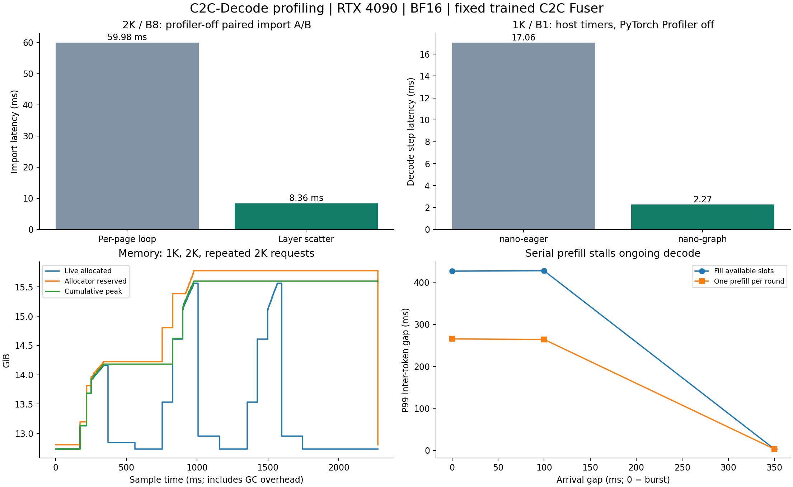
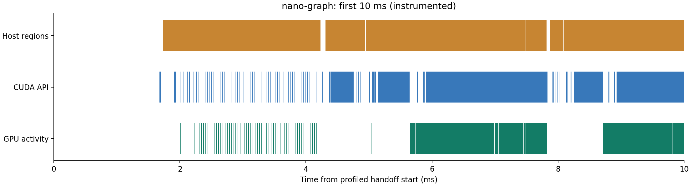

# Profiling and Optimization

[中文版](profiling-results.zh-CN.md)

2026-10-17, RTX 4090 24GB, BF16, pinned Qwen3-4B → Qwen3-0.6B and the official pretrained Fuser. Profiling covers CPU/CUDA timelines, operators, KV import optimization, memory lifecycle and mixed-arrival scheduling. [Measurement summary](../results/profiling/summary.md) is generated from raw JSON.



[Scalable SVG](../results/profiling/overview.svg)

## 1. CPU/GPU timelines and decode costs

PyTorch CPU/CUDA traces cover actual nano-vLLM 1K/B1 and 2K/B8 runs, a 1K/B1 eager control, and separate official prefill/Fuser execution.

For 1K/B1 with 16 output tokens, the median over five profiler-disabled mean step times is **2.268ms** for Graph and **17.056ms** for eager. Each run computes (import+decode−import)/15. Timing wrappers remain active here; formal throughput uses `nano_benchmark` without them. The first token comes from official C2C. Input preparation costs about **0.090ms/step** in host call duration; nested intervals cannot be added. GEMV kernels total about **22.02ms** in the same trace; attention is another major GPU cost. Kernel counts/durations and eager operator shapes are retained. CUDA Graph reduces per-operator host launch costs, not kernels within the graph. DRAM bandwidth, SM occupancy and Tensor Core utilization were not measured; a GEMV name alone does not establish a bandwidth bottleneck.



[Scalable SVG](../results/profiling/timeline.svg)

GPU activity denotes recorded kernel/copy intervals. Coverage is neither `nvidia-smi` utilization nor occupancy; gaps may include profiler perturbation. Eager shape recording adds substantial overhead. Speedups use profiler-disabled experiments, never trace wall time, consistent with [PyTorch Profiler's overhead and tensor-reference documentation](https://docs.pytorch.org/docs/2.8/profiler.html). Nsight Systems was unavailable; no Nsight Compute hardware counters were collected.

## 2. KV import: diagnosis and measured optimization

The old adapter copies per layer and physical page. The new adapter constructs token-to-page/offset mapping once and scatters K/V per layer. `import_mode="scatter"` is default; `loop` remains for comparison. RoPE is not reapplied; positions, first-token handoff and allocation rules are unchanged.

1K/2K × B1/2/4/8 × five randomized pairs gives 40 pairs, each generating 32 tokens per request. Every pair has identical output tokens. Import improves **3.5–7.2×**, with 40/40 pairs faster. At 2K/B8, median import falls **59.98 → 8.36ms** and import+decode **195.63 → 143.97ms**, a **26.4%** reduction. This excludes official prefill and is not full E2E speedup.

A separate 2K/B8 import trace reduces kernel count **3592 → 488**: 3584 page copies become 448 layer writes, plus indexing/first-token work. This supports the diagnosis of excessive small kernels and host launches. Effective payload GB/s counts KV size once, not physical DRAM traffic.

Tests add fragmented pages, partial tails, untouched slots and both import modes; 22 tests passed in the import experiment. Official fused-continuation logits, matched-history teacher forcing, free greedy and reclamation were rerun. Import modes produce matching tokens; cross-engine BF16 errors and top-1 agreement are recorded in the numerical evaluation.

## 3. Memory lifecycle

The measured setup is **one process with official C2C, nano CUDA Graph and a 2044MiB KV pool**. Samples cover receiver/sender forward, layerwise Fuser, post-fusion cleanup, import, dropping HF handoff and decode reclamation, with allocator snapshots containing Python allocation stacks. Some Rosetta calls directly invoke `.forward`, so reversible wrappers are used; ordinary module hooks miss them.

The 1K, 2K, repeated-2K sequence checks whether live allocated returns to its resident value and reserved reflects allocator caching. Import writes into a preallocated pool while HF fused KV stays live until handoff deletion. Each request also checks that official `kv_cache_dict` is empty and paged requests are released.

Resident live allocated is **12.732GiB**; the cumulative 2K peak is **15.603GiB**. All three requests return to the same resident level after dropping handoff. Repeated-2K reserved stabilizes at **15.775GiB**, falling to **12.807GiB** after explicit `empty_cache`. These runs show allocator retention, without accumulating live tensors. Each model creates BF16 logits of shape `[1,2047,151936]` at the end of 2K prefix forward, about **593.2MiB** each. Clean KV clones and fusion intermediates also contribute, so weights+pool alone underestimate peaks. This memory experiment retains full official logits to preserve the reference.

See [memory.json](../results/profiling/memory.json) and the summary for exact GiB, shapes, dtypes and bytes. Allocated, reserved and driver usage are distinct. Limited repetitions do not prove indefinite leak freedom. Snapshot collection follows [PyTorch CUDA memory documentation](https://docs.pytorch.org/docs/2.8/torch_cuda_memory.html). GC and stack tracking perturb timing; the memory chart's time axis cannot establish prefill speedup.

## 4. Arrivals, queueing and prefill interference

Requests include `arrival_ms` and per-token timestamps. Each replay has 24 requests, input lengths cycling through 128/512/1024/2048 and output lengths 16/32/64/128, with EOS early termination disabled. Arrival gaps 0/100/350ms × two policies × three runs total **432 requests**. This is scheduled engine replay without HTTP, network, real streaming clients or production SLA.

The original policy fills available slots with whole prefills; the alternative performs at most one whole prefill per round before decode. It is a scheduling parameter, not chunked prefill or prefill/decode parallelism.

For bursts, inter-token P99 falls **426.6 → 265.3ms** (**37.8%**) while throughput changes **266.0 → 265.4 tok/s**. The 100ms arrival case has a similar P99 improvement. However, burst mean request TPOT worsens **23.94 → 24.74ms**, interval P95 **164.5 → 188.0ms**, and TTFT does not improve. The alternative is therefore **not default**: fewer extreme stalls do not mean all latencies improve.

At 350ms arrivals, original-policy queue P99 is about **2.2ms** and TTFT P99 **267.8ms**, versus burst TTFT P99 about **5.06s**, showing queue buildup from serial prefill. Low-load inter-token P99 near 3.1ms can still miss stalls affecting fewer than 1% of intervals.

P50/P95/P99 are provided for TTFT, queue, E2E, request TPOT and token intervals. TPOT is (last−first token time)/(output count−1) per request; interval percentiles pool adjacent gaps. Each configuration contains only 72 requests, so P99 is an empirical small-sample value, not a stable service-tail claim. Throughput includes arrival-induced idle time. All 18 replays restore initial free-page count.

## 5. Optimized nano audit with an isolated producer

The independent official producer uses same-GPU CUDA IPC, a 2044MiB pool, 1K/2K inputs, B1/2/4/8 with 32 outputs and supplementary B1/128-output runs. Five warmed repetitions per configuration cover free greedy and matched-history teacher forcing. E2E includes IPC and cannot be directly subtracted from in-process timings.

2K/B8 import+decode takes **143.07ms** free greedy and **145.88ms** matched history. B1 fresh-request E2E is **244.77ms at 1K / 331.19ms at 2K**. The 100 decode and ten E2E records pass the original numerical validation set, KV and reclamation checks. Expanded tasks still have threshold failures, documented in the performance and correctness evaluation.

Loading, compilation, tokenization and HTTP are excluded from warmed timing. Original nano data remains unchanged; the current entry is `nano_benchmark.py`. Historical argument fields and trace stacks retain measurement-time values.

## Reproduction and raw artifacts

Use the existing dedicated environment in the server project directory, avoiding local base. Run GPU experiments sequentially on the shared card. Plotting uses Matplotlib 3.10.5, available through the project `profile` extra.

```bash
cd /root/autodl-tmp/c2c-decode
export OMP_NUM_THREADS=8 TOKENIZERS_PARALLELISM=false
export TORCHINDUCTOR_CACHE_DIR=$PWD/.cache/inductor
export TRITON_CACHE_DIR=$PWD/.cache/triton
export MPLCONFIGDIR=$PWD/.cache/matplotlib
PY=/root/autodl-tmp/envs/c2c-decode/bin/python
$PY -m pytest -q
$PY scripts/profile_runtime.py --output-dir results/profiling/nano-graph
$PY scripts/profile_runtime.py --eager --output-dir results/profiling/nano-eager
$PY scripts/profile_experiments.py
$PY -m c2c_decode.nano_benchmark --import-mode scatter --output results/profiling/nano-scatter.json
$PY scripts/summarize_profiling.py
```

To rerun one group, use `profile_experiments.py --section import|memory|scheduling`. Only the memory group was rerun after fixing direct-forward sampling.

| Artifact | Contents |
|---|---|
| `results/profiling/summary.md` | Complete generated measurement tables |
| `nano-graph/`, `nano-eager/` | Raw trials, host stages, CUDA traces, kernel/operator summaries |
| `import-ablation.json` | 80 import/decode records, 40 pairs, order and output tokens |
| `import-loop.json.gz`, `import-scatter.json.gz` | Import-only CPU/CUDA traces |
| `official-prefill.json.gz` | Official two-model/Fuser CPU/CUDA trace |
| `memory.json`, `memory-snapshot.pickle.gz` | Memory samples and allocation-stack snapshot |
| `scheduling.json` | 18 arrival replays, 432 requests' token timestamps and percentiles |
| `nano-scatter.json` | Isolated-producer nano correctness/performance matrix |
| `measurement-provenance.json`, `summary-source-sha256.json`, `tests.txt` | Historical retained-module hashes, summary-time source hashes and tests |

Decompressed trace JSON can be opened in Perfetto; decompressed memory snapshots can be inspected with PyTorch's memory viewer. Raw files remain in the project and were not uploaded to external visualization services. Profiling uses independent scripts. Measurement-time and current source hashes are recorded separately.
