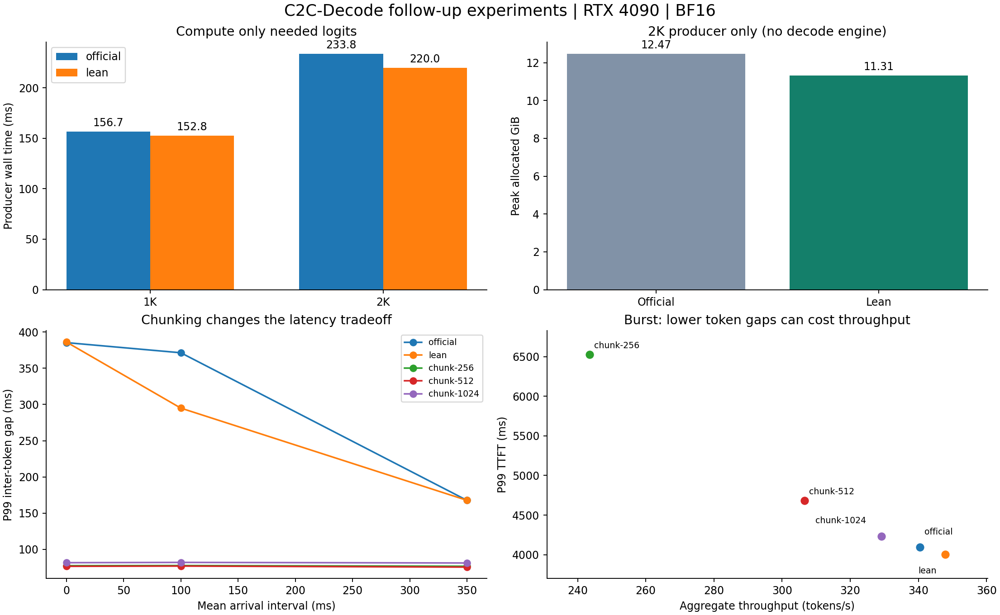

# 性能与正确性评估

[English](results.md)

所有实验固定 Qwen3-4B → Qwen3-0.6B、官方 Fuser、BF16 和 RTX 4090。以下按系统组件与实验配置组织结果；不同配置的耗时与显存不能相加或直接互换。

CLI/服务默认使用精简 prefix logits、scatter 导入和分页解码；分块 prefill 与输入缓冲复用为可选项。Graph 与 eager 分开测量。完整设计及服务复现见 [设计](design.zh-CN.md)，同工作量加速比见 [效率验证](efficiency-verification.zh-CN.md)，导入、时间线和显存归因见 [性能分析](profiling-results.zh-CN.md)。

## 正确性与限制

- 官方 C2C 可用指定 Qwen3-4B → Qwen3-0.6B Fuser 生成。
- 长度 31/255/256/257/1024/2048 的导入 KV 逐元素一致。
- 四个普通 prompt 的 16-token greedy 输出与官方精确一致。
- EOS、变长输出、复用和完整页回收检查通过。
- 基础测试覆盖 CUDA 分页、调度和严格 token CLI 退出门槛；下载权重哈希校验通过，见 `results/tests.txt`。
- 长输入的同历史 logits 通过预设 BF16 阈值，但严格 token 等价未通过：eager top-1 为 88/90，Graph 为 87/90。

Eager 最大绝对误差 0.375、最大 RMSE 0.08594、最小 cosine 0.999341。两处不同 argmax 的官方 margin 为 0.125 和 0.0625，与 BF16 运算路径差异相符。默认 `passed` 是容差和测试夹具门槛，`strict_token_equivalence` 单独记录。原始记录为 `results/validation-eager.json` 与 `validation-graph.json`。

## 官方生产端与逐页导入对照

本节是官方完整 logits、loop 导入配置的对照数据，不代表 CLI/服务默认配置。每档预热，固定生成 32 tokens，取三次中位数。Prefill batch=1；decode 同批输入长度不同，名义长度为最长请求，其余依次短 17 tokens。

| 输入 | 官方 decode B1 | Eager decode B1 | Graph decode B1 | Graph decode B8 | Graph E2E B8 |
|---:|---:|---:|---:|---:|---:|
| 1024 | 42.4 tok/s | 54.3 tok/s | 434.5 tok/s | 2413.5 tok/s | 182.8 tok/s |
| 2048 | 42.6 tok/s | 54.6 tok/s | 405.2 tok/s | 1816.6 tok/s | 123.0 tok/s |

单请求加速应比较 B1，B8 是聚合吞吐。1K/2K 的 Graph B1 E2E 为 135.1/98.7 tok/s，官方为 35.8/33.2 tok/s。这是合成性能测试，不是准确率评测。

Graph B1 TTFT 为 165.3/247.5ms；B8 因包含串行 prefill 排队，中位请求 TTFT 增至 738.4/1106.3ms。

| 单请求阶段 | 1K 中位数 | 2K 中位数 |
|---|---:|---:|
| 接收端＋发送端 prefix forward | 93.206ms | 168.065ms |
| 融合区间，含官方缓存管理 | 43.529ms | 45.904ms |
| 末 prompt token forward | 23.403ms | 23.952ms |
| 缓存校验、分配和导入 | 4.273ms | 8.400ms |

各阶段独立中位数不精确相加为 E2E，定义见 [设计](design.zh-CN.md)。分页模型和图执行的峰值 allocated 为 15.60GiB，官方独立基线为 12.47GiB。2048MiB 预算下池分配 73×28=2044MiB；allocated 不包含 PyTorch 以外的驱动显存。

Graph replay 减少 eager 剩余的主机发射开销，批处理提高聚合吞吐。在本节对照配置的完整链路中，串行 prefill 与融合占主要时间，导入相对较小；未来可探索 prefill/decode 重叠和键设计正确的融合前缀复用。

## 生产端与 CPU 优化的结论

1K/2K、五次随机顺序配对中，生产端完整路径与精简 logits 的中位数分别为：

| 输入 | 官方 prefill | 精简 logits | 耗时下降 |
|---:|---:|---:|---:|
| 1024 | 156.70ms | 152.79ms | 2.5% |
| 2048 | 233.83ms | 219.99ms | 5.9% |

这组显存实验只包含官方生产端模型和 Fuser，**没有 nano 接收模型或分页池**。
2K 的 allocated 峰值 **12.469 → 11.309GiB**，降低约 **1.16GiB**。
六组边界/长输入的精简路径融合 KV 逐元素相同，末 prompt logits 的 RMSE 为 0。
它的性能收益不能与导入对照实验的 26.4% 简单相加。

输入缓冲区复用的独立配对实验中，1K/B1 导入＋解码中位数 **71.603 → 70.918ms**，
2K/B8 **144.430 → 143.307ms**。257/B4 的五组配对中有一组变慢，整体收益约 1%，
因此不作为默认。所有 15 组配对生成 token 相同。

分块单请求 prefill 明显变慢：2K 的 256/512/1024-token chunk 分别约
**514.95/324.34/258.10ms**。它用于减少解码停顿。
完整新请求端到端、随机到达负载、最长停顿和 SLO 数据见自动汇总。

## 完整链路效果与默认选择

新请求每次重新执行 prefill、融合、导入和 decode。每档五次，模式顺序随机；这是
单进程 nano 的计时，不包含 IPC、HTTP、分词、模型加载或编译，也不与历史 IPC 数据直接相减。

| 输入 / 并发 / 每请求输出 | 原始生产端 E2E | 精简 logits E2E | 耗时下降 |
|---|---:|---:|---:|
| 1K / 1 / 32 | 228.49ms | 225.95ms | 1.1% |
| 1K / 1 / 128 | 450.65ms | 445.61ms | 1.1% |
| 1K / 8 / 32 | 1362.67ms | 1325.72ms | 2.7% |
| 2K / 1 / 32 | 311.56ms | 297.64ms | 4.5% |
| 2K / 1 / 128 | 547.21ms | 532.76ms | 2.6% |
| 2K / 8 / 32 | 2009.88ms | 1899.04ms | 5.5% |

120 条端到端记录中，原始生产端、精简 logits、精简＋输入复用的 token 历史均一致。
在 2K/B8 下，额外开启输入复用为 1900.09ms，略慢于 1899.04ms，进一步说明其收益
很小，不宜作为稳定的端到端提速宣传。因此 CLI/服务只默认开启精简 logits。

分块方案包括两模型及融合阶段之间的调度让出，不把效果全部归因于 token chunk 大小。
以下两行都开启精简 logits 和输入缓冲区复用，只比较是否分块；为突发到达、三次回放
共 72 请求的合并分位数，吞吐取各次中位数：

| 策略 | token 间隔 P99 | 最长 token 间隔 | TTFT P99 | 吞吐 |
|---|---:|---:|---:|---:|
| 完整 prefill | 388.24ms | 980.81ms | 4002.99ms | 347.38 tok/s |
| 1024-token chunk | 81.51ms | 83.00ms | 4233.56ms | 329.18 tok/s |

P99 token 间隔降低 **79.0%**，代价是吞吐下降 **5.2%**、TTFT P99 上升 **5.8%**。
在平均到达间隔 350ms 的样本中，固定 SLO 达标请求由 36/72 提升到 72/72；
这只是该有限样本的观察，不是服务承诺。256-token chunk 的突发吞吐仅 243.53 tok/s，
分得更细并不自动更好。分块默认关闭，用户可按停顿与等待时间偏好选择。

37 项测试通过，所有 54 次回放结束后页池恢复到 73 页。
单独的 120.4 秒压力运行提交 589 请求：458 正常完成、85 取消、46 超时，0 引擎错误。
开始与结束的 live allocated 均为 13,678,994,432 bytes，页全部回收。
HTTP 故意把等待队列设为 2，用 4 个客户端线程发起 8 次调用，3 次完成、5 次以 429 拒绝；
另外验证了 DELETE 取消、超时事件、客户端断开和健康检查。

[可缩放矢量图](../results/next/overview.svg)

[完整自动汇总](../results/next/summary.zh-CN.md)保留所有配置与数值失败统计，原始 JSON 位于同目录。

## 扩展正确性与任务质量

任务检查包含 36 个自编功能样例：10 个数学、10 个问答、10 个 Python 输出推理、6 个长上下文
检索。保留题目、期望答案、官方输出、各后端输出和 token IDs；不执行模型生成代码。
这不是 GSM8K/HumanEval 等标准评测，也不能代表整体模型能力。

原始自动评分是严格的规范化答案匹配，额外解释也算不匹配。官方和各适配路径都是
**7/36**；这个分数同时衡量答案内容和格式遵循，不能直接解释成只有七道题内容正确。
例如官方回答 `The answer is 323.` 会因未遵循“只返回答案”而被严格评分判错。
同时也确实存在内容错误，例如官方将 `3*x+7=28` 回答为 `x=3`。

nano 原生产端、精简 logits、512-token 分块均有 **35/36** 个样例
与官方输出逐 token 相同。剩余样例是 FIFO 问题的逗号/连字符不同，对应官方 logits
的 top-1/top-2 margin 为 **0**。该题官方本身也没有按要求回答。各适配路径的回答
彼此一致；本实验未观察到新增答案退化。

扩展的逐步 logits 检查**并非全部通过旧门槛**，不修改 cosine≥0.999、RMSE≤0.15、
max_abs≤1 的标准：nano 在 `math-7` 的一个有效生成步骤 cosine 约 **0.998749**。
nano 的三种生产端在该
失败步骤表现相同，属于既有后端数值差异，不是本实验 logits 优化引入。
512-token 分块还在 `context-0` 新增了一个有效生成步骤的门槛失败；本次输出没有变化，所有分块选项保持实验状态。
另外一些失败出现在强制生成越过 EOS 后；报告同时保留全部检查和 EOS 前/处的分类。
详情见自动汇总和 `numerical-failures.json`。

针对上述分块风险，补测了 1024-token 分块的 6 个长上下文样例：6/6 输出与官方
逐 token 相同，所检查步骤没有触发上述数值门槛，缓存导入精确且页面全部回收。
这只是针对已有长上下文样例的补充检查，并非独立的完整质量评测；1024-token
分块仍保持实验状态、默认关闭。
